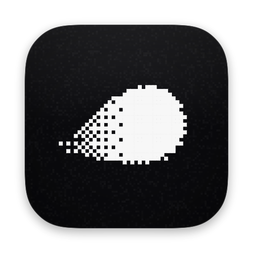
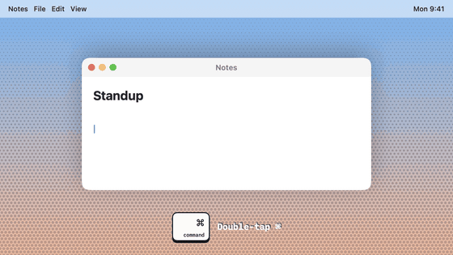
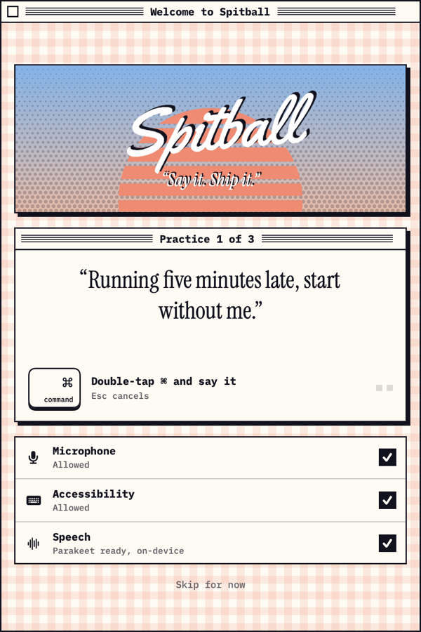
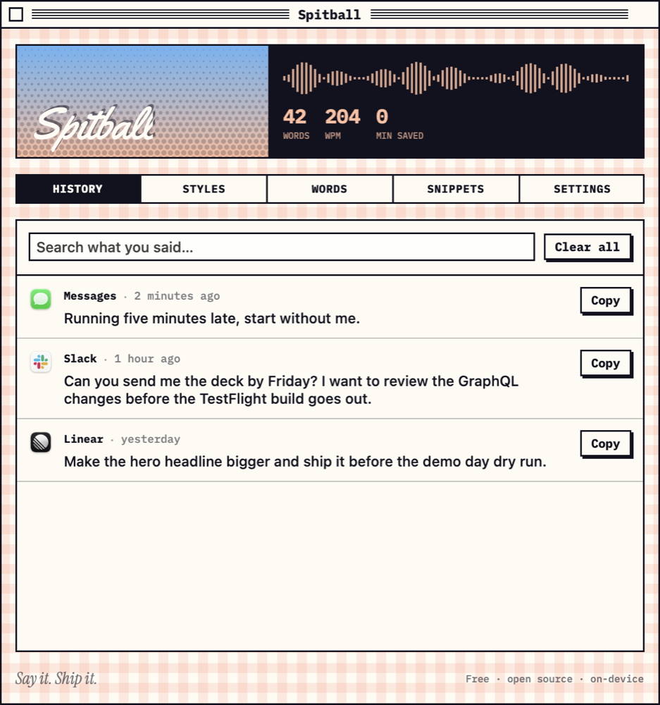

<p align="center">
  
</p>

<h1 align="center">Spitball</h1>

<p align="center">
  <b>Say it. Ship it.</b><br>
  Free, open-source voice dictation for Mac. Double-tap ⌘, talk, and it's typed in any app.<br>
  <a href="https://itsnicksimpson.github.io/spitball/"><b>itsnicksimpson.github.io/spitball</b></a> · try it in your browser
</p>

<p align="center">
  
</p>

---

Dictation apps are great until the monthly bill shows up. Spitball does the core job (talk, and the words land wherever your cursor is) for **$0**, **offline**, and fast enough that it feels like typing with your mouth.

- **⚡️ Instant.** The mic is ready about 0.1 s after you double-tap ⌘. It even starts on your first tap, so your first word never gets clipped. Transcripts land in about 100 ms.
- **🧠 Parakeet on your Neural Engine.** NVIDIA's Parakeet speech model via Core ML, with Apple's on-device speech engine as an automatic backup.
- **🏝 Lives in your notch.** A tiny island grows out of the notch, or wraps the camera on Dynamic Island MacBooks, and your voice ripples out on both sides. A mini waveform hovers over your text caret so you know where the words land.
- **🫧 Calm sounds.** Soft, singing bowl, felt piano, raindrop or breath when recording starts and stops (or none), plus a gentle chime in onboarding.
- **🔄 Updates itself.** Sparkle checks daily and installs signed updates, then shows you what's new.
- **🎙 Notes and meetings, no bot.** ⌃⌘N records a voice note. ⌃⌘M takes meeting notes from your mic *and* your Mac's audio (Zoom, Meet, FaceTime), labels who said what, and writes a summary and action items on your Mac. Copy as Markdown or export.
- **🪄 Smart formatting.** Say a list, get a numbered list. "Scratch that" takes back the last sentence. Emails get a greeting, paragraphs and a sign-off; Cursor gets a clean prompt with `TodoList.tsx` spelled exactly, read from your screen.
- **🤖 Your agents can read your notes.** A local MCP server (`Spitball --mcp`) and a `spitball` command give Claude, Cursor, Codex or ChatGPT read-only access to your notes and dictations. No account, no API key.
- **🌍 25 languages, switch mid-sentence.** Or pick Japanese, Korean, Chinese, Hindi, Arabic and more on Apple's engine.
- **✏️ Command Mode.** Select text, double-tap ⌘, say "make this shorter" or "translate to Spanish". Rewritten in place by Apple Intelligence, on-device.
- **🎨 Styles and your own instructions.** Smart reads the room; or pick formal in Mail, casual in Slack, lowercase in iMessage. Add your own rules ("use British English") for everything or one app.
- **📖 Words, snippets, history.** Teach it "TestFlight" once. Say "my email" and your address appears. Every dictation is saved on your Mac with the app you said it in, plus your words per minute.
- **🎧 AirPods-proof.** With AirPods connected, Spitball listens through your Mac's mic so they stay in high-quality mode and nothing breaks when they hop to your iPhone (toggle in Settings). If a mic ever goes quiet, it recovers on its own.
- **📞 Call-proof.** On FaceTime, Zoom or Meet it turns on Apple's echo and noise cancellation, so other voices stay out of your text.
- **♿️ For everyone.** VoiceOver announcements for every state, Reduce Motion, Increase Contrast, relaxed tap timing.
- **🔒 Private.** No account, no cloud, no telemetry. Optional, opt-in leaderboard shares word counts only.

<p align="center">
  
</p>

## Use it

| Do this | Spitball does |
| --- | --- |
| **Double-tap ⌘** | Bloop. Starts listening |
| **Tap ⌘** | Bloop. Your words are typed where your cursor is |
| **Esc** | Never mind |
| **Select text + double-tap ⌘** | Command Mode: say what to change |
| **⌃⌘V** | Paste your last dictation again |
| **⌃⌘N** | Start or stop a voice note |
| **⌃⌘M** | Start or stop meeting notes (no bot joins) |

Prefer push-to-talk? Pick **Hold Right Option**, **Hold Fn 🌐** or **Hold Right ⌘** in Settings.

## Install

**Download:** [**Spitball.dmg**](https://github.com/itsnicksimpson/spitball/releases/latest/download/Spitball.dmg). Open it and drag Spitball to Applications. First open: right-click → Open (it's not notarized yet). After that it updates itself.

**Homebrew:**

```bash
brew trust itsnicksimpson/spitball
brew install --cask itsnicksimpson/spitball/spitball
```

**Or build it** (Apple Silicon, macOS 26+, Xcode or Command Line Tools):

```bash
git clone https://github.com/itsnicksimpson/spitball.git && cd spitball && ./install.sh
```

The welcome window walks you through Microphone and Accessibility (with an animated guide to the exact switch), then has you say three practice phrases, which light up word by word as you talk. Finish them and you get your **Spitball ID card**, ready to share. The speech model (~600 MB) downloads once; Apple's engine covers you meanwhile.

<p align="center">
  
  
</p>

## The app

Pick your look in the welcome window (switch any time in Settings): **Pro** is clean and minimal, a sidebar and white space. **Playful** is a 1997 Mac on summer vacation: pinstriped title bars, a halftone sunset, gingham, an LCD that counts every word, and four themes (Pacific Breeze, Grape Soda, Lagoon, Mint Julep). Tabs:

- **History:** every dictation, searchable, with app icon, time and one-click copy
- **Notes:** voice notes and meetings with summary, action items and a who-said-what transcript
- **Styles:** a writing style per app
- **Words:** spell names and jargon your way ("TestFlight" also fixes "test flight")
- **Snippets:** say a phrase, type a block of text
- **Settings:** microphone (with a live level meter), talk key, engine, call noise cancellation, um/uh removal, Command Mode, island on/off, caret waveform, sound, look, screen shape, theme, open at login

## How it works

```
double-tap ⌘ ─▶ mic (echo + noise cancellation when you're on a call)
                     │  multi-channel → mono → 16 kHz
tap ⌘ ───────────────▼
               Parakeet (Core ML, Neural Engine) ──fails?──▶ Apple SpeechAnalyzer
                     │
                     ▼
     tidy → style (Apple Intelligence, optional) → your words & snippets
                     │
                     ▼
       paste at your cursor, then put your clipboard back
```

The island is a borderless, non-activating panel over the camera cutout, so focus never leaves your app. macOS has no public API for the Dynamic Island, so Spitball draws its own.

## Agents (MCP + CLI)

Settings → Notes & agents → **Copy MCP config**, then paste it into Claude, Cursor or Codex:

```json
{ "mcpServers": { "spitball": { "command": "/Applications/Spitball.app/Contents/MacOS/Spitball", "args": ["--mcp"] } } }
```

Tools: `list_notes`, `get_note`, `search_dictations`, `get_stats`. Read-only, local. Or **Install spitball command**:

```bash
spitball notes            # list notes
spitball note latest      # newest note as Markdown
spitball history standup  # search what you've dictated
```

## Self-test

```bash
say -o /tmp/hello.aiff "Um, testing one two three."
.build/release/Spitball --self-test /tmp/hello.aiff
```

Checks the double-tap logic, cleanup, dictionary and snippets, both engines on real audio, Apple Intelligence styles and Command Mode, and renders every screen to `shots/`.

## Website

The site in [`docs/`](docs) is plain HTML, CSS and a little JS (animations by [Motion](https://motion.dev)), served by GitHub Pages. `python3 scripts/build_pages.py` regenerates the comparison pages, sitemap, `robots.txt` and `llms.txt`. The optional leaderboard server lives in [`server/`](server).

## Credits

- [FluidAudio](https://github.com/FluidInference/FluidAudio) (Apache 2.0) runs Parakeet on Core ML. [Parakeet](https://huggingface.co/FluidInference/parakeet-ultra-coreml) by NVIDIA (CC-BY-4.0).
- Fonts: Yellowtail (Apache 2.0), IBM Plex Mono and Instrument Serif (OFL).
- Party GIFs on the site: Eadweard Muybridge (1887), *The Skeleton Dance* (1929), a CC0 disco ball. Public domain, via Wikimedia Commons.

Spitball is an independent project, not affiliated with Apple, NVIDIA, Wispr, Every or Superwhisper.

## License

MIT. Fork it, ship it, make it yours.

## Releasing

```bash
scripts/release.sh 2.3.5 "What changed"   # build, ad-hoc sign, zip + DMG, Sparkle-sign, update docs/appcast.xml, publish
```

The Sparkle private key lives in the maintainer's login keychain (account `spitball`); the public key is in `Info.plist`.
